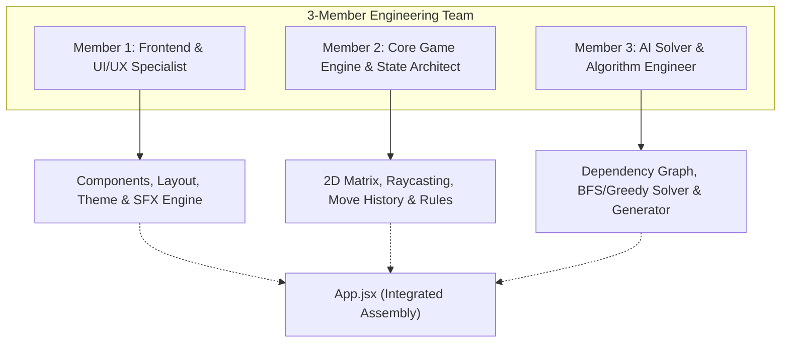
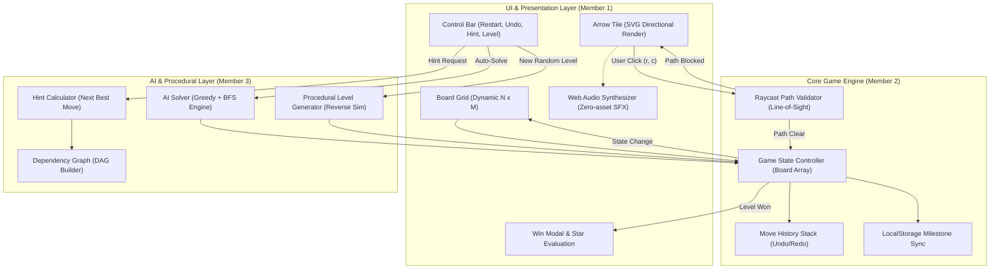
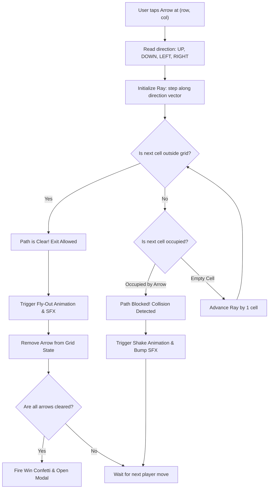
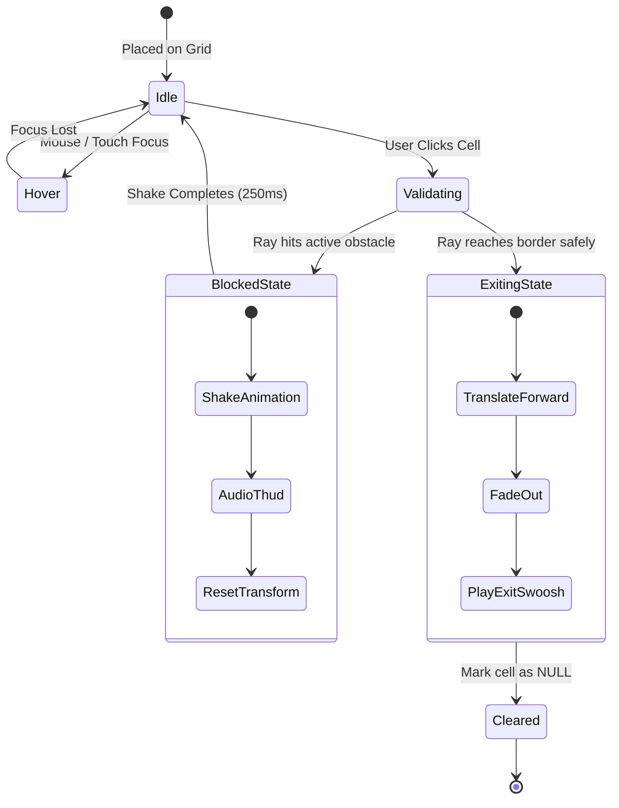
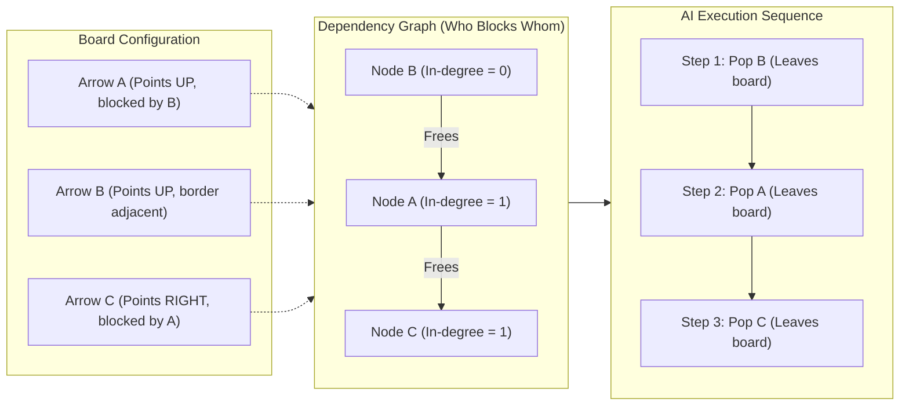
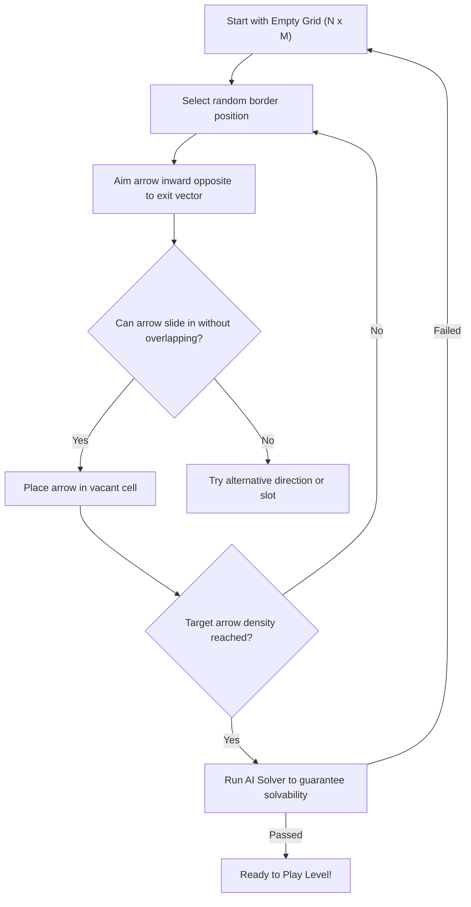

# 🏹 AGENTS.md — Arrow Puzzle & AI Solver: Master Project Specification & Architecture

> **Document Version:** 1.0.0  
> **Project Title:** Arrow Puzzle (Arrow Out / Directional Logic Escape) & AI Solver Engine  
> **Target Release:** v1.0.0 (Responsive Web App & PWA)  
> **Team Composition:** 3 Core Engineers (FYP Warm-Up / Logic & Algorithm Mastery)  
> **Last Updated:** October 2026  

---

## 1. Executive Summary & Project Definition

### What is Arrow Puzzle?
**Arrow Puzzle** is a high-performance, grid-based logic escape game and algorithmic showcase. In this game, cells on an $N \times M$ grid are populated with directional arrows pointing **Up (↑)**, **Down (↓)**, **Left (←)**, or **Right (→)**.

When a player taps an arrow:
1. **Raycasting / Path Clearance:** The game engine shoots a ray along the arrow's pointing trajectory towards the border of the board.
2. **Clear Path (Exit):** If no other active arrow blocks the path to the perimeter, the arrow glides smoothly out of the board with custom physics, freeing up space for previously blocked arrows.
3. **Blocked Path (Collision):** If any arrow blocks the path, the clicked arrow vibrates with a haptic/visual shake animation, and feedback is triggered.
4. **Victory Condition:** The level is won when all arrows have successfully exited the grid.

### Why this Project for FYP Preparation?
This project is engineered specifically to transition our 3-member team into production-grade software engineering before launching into our Final Year Project (FYP). It bridges theoretical computer science concepts with practical engineering:
- **Graph Theory & DAGs (Directed Acyclic Graphs):** Arrow blockages represent dependency relationships (Arrow $A$ depends on Arrow $B$ exiting first).
- **Search & Optimization Algorithms:** Multi-tier AI Solver implementing Greedy heuristics, Breadth-First Search (BFS) for optimal hint sequences, and topological resolution.
- **Procedural Content Generation (PCG):** Reverse-backtracking level generator that guarantees 100% solvability.
- **Modern Reactive UI/UX:** React + Vite, hardware-accelerated CSS/Framer Motion animations, and pure Web Audio API synthesizer.
- **Multi-Developer Git Workflow:** Real-world trunk-based branch management, PR reviews, and modular ownership across 3 engineers.

---

## 2. Problem Statement & Proposed Solution

### The Problem
1. **Lack of Practical Algorithmic Foundation:** Many students enter their FYP knowing algorithm syntax but lacking hands-on experience applying search algorithms (BFS, DFS, Greedy) to interactive real-time systems.
2. **Monolithic Coding Habits:** Teams often work on a single file or step on each other's code due to poor separation of concerns between game logic, UI components, and state management.
3. **Fragile Level Design:** Puzzle games often feature handcrafted levels that run out quickly or randomly generated boards that are mathematically impossible to solve.
4. **Heavy Asset Bloat:** Many web games rely on heavy external `.mp3` or 3D engines that fail to load offline or cause latency.

### The Solution
1. **Clean Separation of Concerns:** Complete decoupling into three independent modules: **UI/UX Presentation Layer**, **Deterministic Game Engine**, and **Autonomous AI Solver & Generator**.
2. **Guaranteed Solvability via Reverse Simulation:** The generator starts with an empty board and places arrows by pulling them inward along empty paths (inverse of exiting). Every generated level is mathematically guaranteed to have at least one valid escape path.
3. **Built-in AI Assistant & Visual Solver:** Players can request hints (showing the next optimal move via BFS) or trigger "Auto-Solve" where the AI clears the board step-by-step with visual playback controls.
4. **100% Zero-Asset Synthesizer:** Pure browser Web Audio API generates interactive mechanical clicks, smooth swooshes, blocked bumps, and celebratory chimes without external `.mp3` dependencies.
5. **Progressive Web App (PWA) & Local Storage:** Offline play capability with automatically saved level milestones, move counters, and star ratings.

---

## 3. Goals & Non-Goals

### Project Goals
- **G1 — 60 FPS Fluid Animation:** Smooth arrow flight animations (CSS transforms / Framer Motion) when arrows leave the grid.
- **G2 — Deterministic Raycast Engine:** Sub-millisecond path collision detection across arbitrary grid sizes ($3 \times 3$ to $10 \times 10$).
- **G3 — Visual AI Solver:** Real-time step-by-step solution solver with interactive playback controls (Play, Pause, Step Forward, Speed Slider).
- **G4 — Intelligent Hint System:** Suggest the next best legal move by calculating the branch that maximizes unlocked downstream arrows.
- **G5 — Reverse Backtracking Level Generator:** Instant creation of procedural levels across three difficulty tiers (Easy $4 \times 4$, Medium $6 \times 6$, Hard $8 \times 8$).
- **G6 — Zero External Dependencies for Audio:** Pure oscillator-based sound effects for clicks, escapes, collision errors, and win fanfares.
- **G7 — 100% Mobile & Desktop Responsive:** Auto-scaling grid viewport that adapts flawlessly from smartphone screens to 4K monitors.

### Non-Goals
- **NG1 — Heavy 3D Graphics (Three.js/WebGL):** Avoid unnecessary 50MB+ bundle bloat; utilize lightweight 2D vectors and CSS hardware acceleration.
- **NG2 — Heavy Server/Backend Database for MVP:** Game progress, level stats, and settings persist client-side via `localStorage`.
- **NG3 — Paywalls or Ads in Dev Phase:** Focus 100% on algorithmic purity and user experience.

---

## 4. 3-Member Team Division & Ownership Matrix

To ensure zero conflicts and balanced workloads, project responsibilities are divided into 3 specialized roles:



| Member | Specialization | Core Responsibilities | Key Files Owned |
| :--- | :--- | :--- | :--- |
| **Member 1** | **Frontend & UI/UX Specialist** | • Responsive Grid Component & Arrow SVG styling<br>• Dynamic CSS rotations (0°, 90°, 180°, 270°)<br>• Arrow exit slide-out and blocked shake animations<br>• Control panels, Win Modal, Timer & Move counters<br>• Web Audio API sound synthesizer engine | `src/components/Board.jsx`<br>`src/components/ArrowCell.jsx`<br>`src/components/Controls.jsx`<br>`src/components/WinModal.jsx`<br>`src/utils/soundEffects.js` |
| **Member 2** | **Core Game Engine & State Architect** | • 2D Grid coordinate system & Board representation<br>• Raycasting collision detection (Border-path check)<br>• Move execution, Arrow removal, Undo/Redo history<br>• Win condition detection & Level progression<br>• Handcrafted level catalog (`levels.js`) & LocalStorage | `src/engine/gameRules.js`<br>`src/engine/pathValidator.js`<br>`src/engine/gameState.js`<br>`src/data/levels.js`<br>`src/utils/storage.js` |
| **Member 3** | **AI Solver & Algorithm Engineer** | • Arrow dependency mapping (Directed Acyclic Graph)<br>• Greedy Solver (Fast solution pathfinding)<br>• BFS Solver (Shortest move hint sequences)<br>• Reverse-Backtrack Procedural Level Generator<br>• Solvability validator & Auto-play playback controller | `src/ai/dependencyGraph.js`<br>`src/ai/solver.js`<br>`src/ai/hintEngine.js`<br>`src/ai/levelGenerator.js`<br>`src/components/SolverControls.jsx` |

> **Shared Team Responsibilities:**
> - Git branch discipline: `main` (protected), `feature/ui`, `feature/engine`, `feature/solver`.
> - Code reviews via Pull Requests before merging.
> - Joint end-to-end integration testing and Vercel deployment.

---

## 5. Technical Stack & Tooling

| Layer | Technology | Version | Purpose |
| :--- | :--- | :--- | :--- |
| **Runtime & Framework** | React.js | `^18.3.1` / React 19 | Declarative UI and component state management |
| **Build Tool** | Vite | `^5.4.11` | Blazing fast HMR and optimized production bundling |
| **Styling** | Tailwind CSS | `^3.4.14` | Utility classes, grid systems, and glassmorphism |
| **Motion & FX** | CSS Keyframes + Canvas-Confetti | `^1.9.4` | Smooth 60fps arrow fly-outs and celebratory victory bursts |
| **Icons** | Lucide React | `^0.456.0` | Navigation, undo, hint, play, pause, and directional icons |
| **Audio Synthesizer** | Web Audio API | Native Browser | Zero-asset synthetic sound effects (oscillator nodes) |
| **State Persistence** | Web LocalStorage API | Native Browser | High scores, current level, audio settings |
| **Version Control** | Git + GitHub | Cloud | Branching, code reviews, collaboration |
| **Hosting & CI/CD** | Vercel | Production Edge | Instant preview deployments on push |

---

## 6. Architectural Mermaid Diagrams

### 6.1 System Architecture Diagram


---

### 6.2 Raycast & Arrow Movement Flowchart


---

### 6.3 State Machine for Arrow Cell


---

### 6.4 Dependency Graph & AI Topological Solver


---

### 6.5 Procedural Level Generation (Reverse Backtracking)


---

## 7. Detailed File & Project Structure

```text
e:/Arrow Puzzle/
│
├── public/                         # Public static assets
│   ├── favicon.svg                 # Directional compass icon
│   └── manifest.json               # Progressive Web App manifest
│
├── src/
│   ├── ai/                         # 🧠 Member 3: AI Solver & Procedural Generation
│   │   ├── dependencyGraph.js      # Computes blockers & DAG relationships
│   │   ├── solver.js               # Greedy solver & Full solution generator
│   │   ├── hintEngine.js           # BFS algorithm to identify best immediate move
│   │   └── levelGenerator.js       # Reverse-simulation guaranteed solvable generator
│   │
│   ├── components/                 # 🎨 Member 1: UI, Animations & Layout
│   │   ├── ArrowCell.jsx           # Individual arrow tile with rotation & shake/fly CSS
│   │   ├── Board.jsx               # Responsive grid layout with touch & click bindings
│   │   ├── Controls.jsx            # Action bar (Undo, Reset, Hint, Level Select, Auto-Solve)
│   │   ├── Header.jsx              # Logo, Level indicator, Move counter & Timer
│   │   ├── LevelModal.jsx          # Level selection grid (1 to 20 + Endless Mode)
│   │   ├── SolverControls.jsx      # Auto-play player (Play, Pause, Speed Slider, Step)
│   │   └── WinModal.jsx            # Victory screen, star rating, confetti & Next Level CTA
│   │
│   ├── data/                       # 📋 Member 2: Level Configurations
│   │   └── levels.js               # 20 curated campaign levels (Easy to Hard)
│   │
│   ├── engine/                     # ⚙️ Member 2: Core Game Rules & State
│   │   ├── gameRules.js            # Direction vectors, coordinate helpers & game boundaries
│   │   ├── gameState.js            # Immutable board updates, move stacks & score tracking
│   │   └── pathValidator.js        # Raycasting line-of-sight clearance checker
│   │
│   ├── utils/                      # 🛠️ Shared Helpers & Hardware API
│   │   ├── soundEffects.js         # Member 1: Web Audio API Synthesizer (Swoosh, Thud, Win)
│   │   └── storage.js              # Member 2: LocalStorage level & settings persistence
│   │
│   ├── App.jsx                     # Master application controller & mode switcher
│   ├── index.css                   # Tailwind imports, custom keyframe animations & variables
│   └── main.jsx                    # React DOM entry point
│
├── .gitignore                      # Node modules, dist, and local dev exclusions
├── AGENTS.md                       # Master Architecture & Engineering Specification
├── index.html                      # HTML entry with viewport scaling & Google Fonts
├── package.json                    # Scripts and project dependencies
├── postcss.config.js               # PostCSS plugins
├── tailwind.config.js              # Custom theme, animations, and color scheme
└── vite.config.js                  # Vite configuration
```

---

## 8. Rules, Standards & Engineering Conventions

### 8.1 Grid Coordinate & Orientation Standards
1. **Zero-Indexed Coordinate System:** Board positions must always use `(row, col)` with `(0, 0)` at the **top-left** cell.
2. **Direction Enums:** Directions must strictly use uppercase strings:
   ```javascript
   export const DIRECTIONS = {
     UP: 'UP',       // row - 1, col + 0  (Rotation: 0deg)
     RIGHT: 'RIGHT', // row + 0, col + 1  (Rotation: 90deg)
     DOWN: 'DOWN',   // row + 1, col + 0  (Rotation: 180deg)
     LEFT: 'LEFT'    // row + 0, col - 1  (Rotation: 270deg)
   };
   ```
3. **Delta Vector Map:**
   ```javascript
   export const DELTA = {
     UP:    { r: -1, c:  0 },
     DOWN:  { r:  1, c:  0 },
     LEFT:  { r:  0, c: -1 },
     RIGHT: { r:  0, c:  1 }
   };
   ```

### 8.2 Raycast Verification Protocol
Every move tap must pass through the `isPathClear(board, row, col)` method:
```javascript
export function isPathClear(board, startRow, startCol) {
  const arrow = board[startRow][startCol];
  if (!arrow) return false;

  const { r: dr, c: dc } = DELTA[arrow.direction];
  let currR = startRow + dr;
  let currC = startCol + dc;

  const numRows = board.length;
  const numCols = board[0].length;

  while (currR >= 0 && currR < numRows && currC >= 0 && currC < numCols) {
    if (board[currR][currC] !== null) {
      return { clear: false, blockedBy: { r: currR, c: currC } };
    }
    currR += dr;
    currC += dc;
  }
  return { clear: true };
}
```

### 8.3 Synthesizer Audio Rules (Zero-Asset Web Audio API)
1. **Autoplay Policy Compliance:** Audio context is initialized lazily upon the player's first gesture (`click` or `touchstart`).
2. **Zero File Downloads:** Never import external audio files (`.mp3`/`.wav`). Sounds are generated via `OscillatorNode` and `GainNode`:
   - **Click/Tap:** Quick high-frequency sine pip (800Hz $\rightarrow$ 400Hz, 40ms).
   - **Slide Out / Exit:** Upward frequency glide sine wave (300Hz $\rightarrow$ 850Hz, 180ms).
   - **Blocked Collision:** Low-frequency square wave thud (120Hz $\rightarrow$ 60Hz, 120ms).
   - **Victory Fanfare:** 4-chord arpeggio sequence (C5, E5, G5, C6).

### 8.4 Git Collaboration Workflow for 3 Members
1. **Branch Naming Standard:**
   - `feat/ui-animations` (Member 1)
   - `feat/engine-raycasting` (Member 2)
   - `feat/ai-solver-generator` (Member 3)
2. **Commit Message Format:** Follow Conventional Commits:
   - `feat(engine): implement raycast line of sight check`
   - `fix(ui): adjust shake keyframe timing on mobile`
   - `feat(ai): add reverse backtrack puzzle generator`
3. **Pull Request Protocol:** Before merging to `main`, at least one peer member must test and approve the PR.

---

## 9. Campaign Level Catalog & Progression

The game ships with 20 handcrafted campaign levels increasing in complexity, plus an **Endless AI Generator Mode**:

| Level Tier | Level Range | Grid Size | Arrow Count | Strategic Focus |
| :--- | :--- | :--- | :--- | :--- |
| **Tutorial** | Levels 1–3 | $3 \times 3$ | 4–6 Arrows | Basic raycast mechanics, border exits |
| **Beginner** | Levels 4–7 | $4 \times 4$ | 8–10 Arrows | Single dependencies, unblocking paths |
| **Intermediate** | Levels 8–12 | $5 \times 5$ | 14–18 Arrows | Multi-step dependency chains & loops |
| **Advanced** | Levels 13–17 | $6 \times 6$ | 22–26 Arrows | Bottlenecks, perimeter traps |
| **Master** | Levels 18–20 | $7 \times 7$ & $8 \times 8$ | 30–40 Arrows | Complex topological graphs |
| **Endless AI Mode** | Infinite | Custom ($4 \times 4$ to $8 \times 8$) | Dynamic | Procedurally generated solvable levels on demand |

---

## 10. Verification, Testing & Build Instructions

### Initial Project Setup
```powershell
# Navigate to the workspace
cd "e:\Arrow Puzzle"

# Install project dependencies
npm install
```

### Local Development Server
```powershell
# Launch Vite live hot-reload server
npm run dev
```

### Production Build & Verification
```powershell
# Compile production bundle
npm run build
```
**Expected Build Artifacts:**
- `dist/index.html` (~1.5 kB)
- `dist/assets/*.css` (Clean Tailwind output, ~15 kB)
- `dist/assets/*.js` (Fast bundled JS, <150 kB)
- Exit Code: `0` with zero build or lint warnings.

### Cloud Deployment to Vercel
```powershell
# Deploy straight from terminal or connect GitHub repo to vercel.com
npx vercel --prod
```
